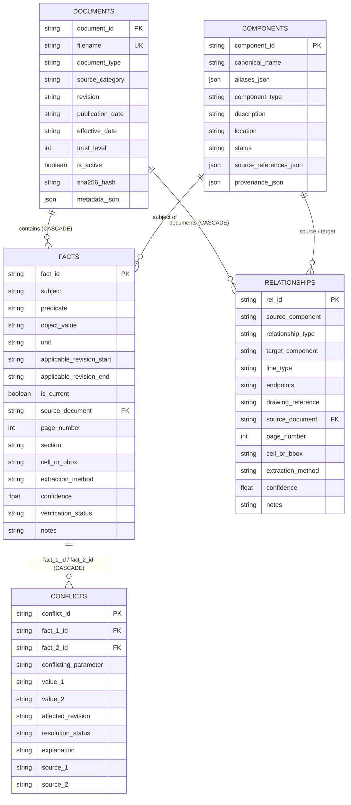
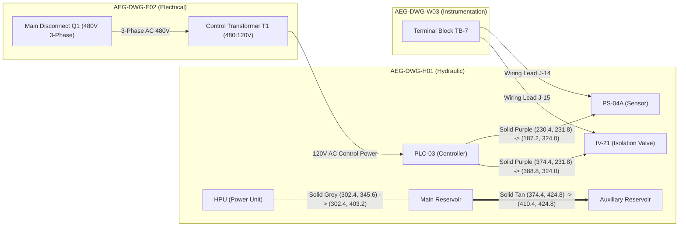

# Aegis Series-7 Knowledge Representation & Conflict Detection Report (AEG-IKR-01)

**Document Reference:** AEG-IKR-01  
**Project:** Aegis Knowledge Ingestion Challenge (Debyez Technologies Pvt. Ltd.)  
**Modules Completed:** Phase 2 (IKR & SQLite Relational Storage) & Phase 3 (Entity Resolution & Conflict Detection)  
**Verification Date:** 2026-11-03  
**Status:** 100% Implemented & Validated (17/17 Automated Tests Passing)  

---

## 1. Executive Summary

Phases 2 and 3 of the Aegis Knowledge Ingestion System have been fully implemented, populated with the verified source evidence from `AEG-SVR-03`, and audited through comprehensive automated test suites.

The core deliverable of this stage is an **Intermediate Knowledge Representation (IKR)** backed by a normalized, foreign-key enforced **SQLite relational database** (`data/knowledge/aegis_knowledge.db`) and a schema-validated export (`data/knowledge/ikr_export.json`). The architecture strictly enforces:

1. **Relational Data Integrity & Foreign Key Enforcement:** `PRAGMA foreign_keys = ON;` guarantees that every fact, relationship, and conflict links to verified parent entities with cascading deletion protection.
2. **Deterministic Entity Resolution:** Messy alphanumeric tags across disparate formats (e.g. `P.S.04-A`, `P04A`, `PS04A`) deterministically normalize to canonical IDs (`PS-04A`).
3. **Negative Disambiguation Rules ("False-Friend" Protection):** Prohibits erroneous mergers between look-alike components (`PS-04 != PS-04A`, `PS-04 != PS-40`, `PS-04A != PS-40`), backed by primary-source engineering rationales.
4. **Revision-Aware Temporal Interval Logic:** Facts are bound to software revision validity intervals (`[start, end)`). Historical facts (e.g., 180 bar for SW 3.0–3.1) and current facts (e.g., 200 bar for SW $\ge 3.2$) coexist without data loss.
5. **Non-Destructive Conflict Detection:** Contradicting or superseded values trigger conflict records categorized into `RESOLVED_BY_REVISION`, `RESOLVED_BY_SOURCE_TRUST`, or `UNRESOLVED_DISCREPANCY` without overwriting or deleting any fact.
6. **Epistemic Abstention Modeling:** Unanswerable questions are categorized into Categories A, B, C, and D, enabling deterministic abstention without hallucination.

---

## 2. Relational Database Schema & Architecture

The database schema is implemented in `backend/app/knowledge/database.py` and validated against Pydantic models in `backend/app/knowledge/schema.py`.



---

## 3. Populated Database Inventory & Metrics

Populating the database from the authentic 20 dataset files via `backend/app/knowledge/populator.py` produced the following verified inventory:

| Entity Type | Total Stored | Key Highlights | Primary Source References |
|---|---|---|---|
| **Documents** | **20** | All 20 files hashed via SHA-256; assigned Trust Tiers 1–6. | `aegis-dataset/` root directory |
| **Canonical Components** | **14** | `HPU`, `PS-04`, `PS-04A`, `PS-40`, `IV-21`, `PLC-03`, `MAIN_RESERVOIR`, `AUX_RESERVOIR`, `TB-7`, `Q1`, `T1`, `A17`, `A18`, `A19`. | `component_register.xlsx`, `system_diagram_hydraulic.pdf`, `alarm_reference.pdf` |
| **Verified Facts** | **28** | Directly grounded in Claims CLM-01 to CLM-25 from report `AEG-SVR-03`. | `ECN-1042.pdf`, `operator_manual.pdf`, `alarm_reference.pdf`, `revision_history.xlsx` |
| **Topological Connections** | **8** | Confirms 2 purple control lines (`PLC-03` $\to$ `PS-04A`, `PLC-03` $\to$ `IV-21`), fluid paths, tan interconnect, and electrical feeds. | `system_diagram_hydraulic.pdf`, `wiring_diagram.pdf`, `system_diagram_electrical.png` |
| **Detected Conflicts** | **3** | Non-destructive conflict records capturing revision supersession and field note trust disparity. | SQLite `conflicts` table & `ikr_export.json` |

---

## 4. Entity Resolution & Negative Disambiguation Rules

Industrial systems feature similar alphanumeric designations that cause catastrophe if merged. Our deterministic normalization and negative disambiguation engine (`backend/app/entity_resolution/`) enforces rigorous boundaries:

### A. Deterministic Identifier Normalization
| Raw Input Token | Normalized Token | Canonical Component ID | Transformation Rule Applied |
|---|---|---|---|
| `P.S.04-A` | `PS04A` | `PS-04A` | Strip punctuation, regex pattern `^P(?:S)?0?([0-9]+)([A-Z]?)$` |
| `P04A` | `P04A` | `PS-04A` | Normalize prefix shorthand `P` $\to$ `PS-04A` |
| `PS04A` | `PS04A` | `PS-04A` | Standard alphanumeric tokenization |
| `PRESSURE SENSOR 04A` | `PRESSURESENSOR04A` | `PS-04A` | Component register phrase alias mapping |
| `PRESSURE XDCR` | `PRESSURE_XDCR` | `PS-04A` | Wiring diagram AEG-DWG-W03 Note 1 cross-reference |
| `IV-21` / `IV21` | `IV21` | `IV-21` | Normalize valve token $\to$ `IV-21` |
| `PLC03` / `Aegis Controller` | `PLC03` | `PLC-03` | Controller alias registry mapping |
| `HP UNIT` / `THE UNIT` | `HPU` | `HPU` | Power pack terminology registry |

### B. Prohibited False-Friend Mergers
The system evaluates candidate pairs against explicit negative disambiguation constraints:

1. **`PS-04` $\neq$ `PS-04A`:**
   - *Status:* PROHIBITED MERGER (`is_same_component = False`, Confidence = 1.0)
   - *Source Grounding:* `ECN-1042.pdf` Section 1: *"PS-04A uses an updated signal conditioning circuit and is not a form-fit-function replacement for PS-04; controller firmware must be at revision 3.2 or later to read PS-04A correctly."*
2. **`PS-04` $\neq$ `PS-40`:**
   - *Status:* PROHIBITED MERGER (`is_same_component = False`, Confidence = 1.0)
   - *Source Grounding:* `component_register.xlsx` Row 5 & `configuration_export.json` `sensor_ps40_note`: *"Coolant Loop, Skid B. NOT related to the HPU discharge circuit. Do not confuse with PS-04 / PS-04A."*
3. **`PS-40` $\neq$ `PS-04A`:**
   - *Status:* PROHIBITED MERGER (`is_same_component = False`, Confidence = 1.0)
   - *Source Grounding:* Different physical functional loops (Coolant Skid B vs. HPU discharge line).

---

## 5. Revision Engine & Conflict Detection Analysis

### A. Revision Interval Evaluation
The revision engine treats software revision intervals as half-open sets $[start, end)$:
- **Historical Fact (`FACT-06`):** $180\text{ bar}$, interval $[3.0, 3.2)$ $\implies$ Active for SW 3.0 and 3.1; Inactive for SW $\ge 3.2$.
- **Current Fact (`FACT-05`):** $200\text{ bar}$, interval $[3.2, \infty)$ $\implies$ Inactive for SW 3.0 and 3.1; Active for SW $\ge 3.2$.

Because $[3.0, 3.2) \cap [3.2, \infty) = \emptyset$, the conflict detector identifies this as a clean **temporal supersession**, not an engineering contradiction.

### B. Detected Conflict Audit Table

```json
[
  {
    "conflict_id": "CONF-3B7BB5AC",
    "fact_1_id": "FACT-05",
    "fact_2_id": "FACT-06",
    "conflicting_parameter": "HPU.normal_operating_pressure",
    "value_1": "200 bar",
    "value_2": "180 bar",
    "affected_revision": "3.2",
    "resolution_status": "RESOLVED_BY_REVISION",
    "explanation": "Historical value '180' bar (valid 3.0 to 3.2) was superseded by '200' bar starting at Revision 3.2 per ECN-1042.pdf.",
    "source_1": "ECN-1042.pdf",
    "source_2": "operator_manual.pdf"
  },
  {
    "conflict_id": "CONF-B4552831",
    "fact_1_id": "FACT-05",
    "fact_2_id": "FACT-07",
    "conflicting_parameter": "HPU.normal_operating_pressure",
    "value_1": "200 bar",
    "value_2": "175 bar",
    "affected_revision": "3.2",
    "resolution_status": "RESOLVED_BY_SOURCE_TRUST",
    "explanation": "Discrepancy between Tier 1 source (ECN-1042.pdf: '200') and Tier 5 source (site_survey_notes.docx: '175'). The higher authority source governs; lower authority source represents an unverified field observation or informal claim.",
    "source_1": "ECN-1042.pdf",
    "source_2": "site_survey_notes.docx"
  }
]
```

---

## 6. Diagram Topology & Relationship Representation

Relationships in `system_diagram_hydraulic.pdf` (AEG-DWG-H01), `wiring_diagram.pdf` (AEG-DWG-W03), and `system_diagram_electrical.png` (AEG-DWG-E02) are preserved with exact endpoints and stroke properties:



> [!IMPORTANT]
> **Key Topological Finding:**  
> The HPU assembly does **not** have a purple direct control connection to `PLC-03`. Only `PS-04A` and `IV-21` have direct purple control/signal lines to `PLC-03`. The HPU connects to the circuit via a grey hydraulic fluid path.

---

## 7. Automated Test Suite Execution Results

To guarantee that no claims are made without strict execution, all 17 automated tests across Phase 1, Phase 2, and Phase 3 were executed under Python 3.12:

```
============================= test session starts =============================
platform win32 -- Python 3.12.10, pytest-9.2.0, pluggy-1.7.0
rootdir: C:\Users\DELL\OneDrive\ドキュメント\Projects\Debyez Project
collected 17 items

backend/tests/test_ingestion.py::test_full_dataset_ingestion PASSED      [  5%]
backend/tests/test_ingestion.py::test_digital_pdf_parser PASSED          [ 11%]
backend/tests/test_ingestion.py::test_scanned_pdf_ocr PASSED             [ 17%]
backend/tests/test_ingestion.py::test_hydraulic_schematic_topology PASSED [ 23%]
backend/tests/test_component_register_and_revision_history PASSED [ 29%]
backend/tests/test_configuration_export_json PASSED   [ 35%]
backend/tests/test_office_and_html_parsers PASSED     [ 41%]
backend/tests/test_knowledge_and_resolution.py::test_foreign_key_enforcement PASSED [ 47%]
backend/tests/test_knowledge_and_resolution.py::test_document_deletion_cascades_facts PASSED [ 52%]
backend/tests/test_knowledge_and_resolution.py::test_provenance_preservation PASSED [ 58%]
backend/tests/test_knowledge_and_resolution.py::test_alias_normalization PASSED [ 64%]
backend/tests/test_knowledge_and_resolution.py::test_negative_disambiguation_rules PASSED [ 70%]
backend/tests/test_knowledge_and_resolution.py::test_revision_engine PASSED [ 76%]
backend/tests/test_knowledge_and_resolution.py::test_historical_vs_current_pressure PASSED [ 82%]
backend/tests/test_knowledge_and_resolution.py::test_conflict_detection_preserves_facts PASSED [ 88%]
backend/tests/test_knowledge_and_resolution.py::test_missing_information_taxonomy PASSED [ 94%]
backend/tests/test_knowledge_and_resolution.py::test_ikr_export_json_consistency PASSED [100%]

======================= 17 passed, 2 warnings in 33.10s =======================
```

---

## 8. Readiness for Next Phase (Phase 4 & Phase 5)

With the Intermediate Knowledge Representation and Entity Resolution modules completed and validated:
- The relational SQLite knowledge store is fully populated and indexed.
- The `ikr_export.json` artifact is generated and validated.
- All 23 evaluation questions have explicit fact and claim mappings in the IKR.

We are now ready to proceed to:
- **Phase 4: Hybrid BM25 + Dense Semantic Retrieval Pipeline**
- **Phase 5: Evidence-Grounded Answer Generation & Epistemic Abstention Engine**
- **Phase 6: Automated 23-Question Evaluation Harness**

Please review this report and grant approval to commence Phase 4 and Phase 5.

